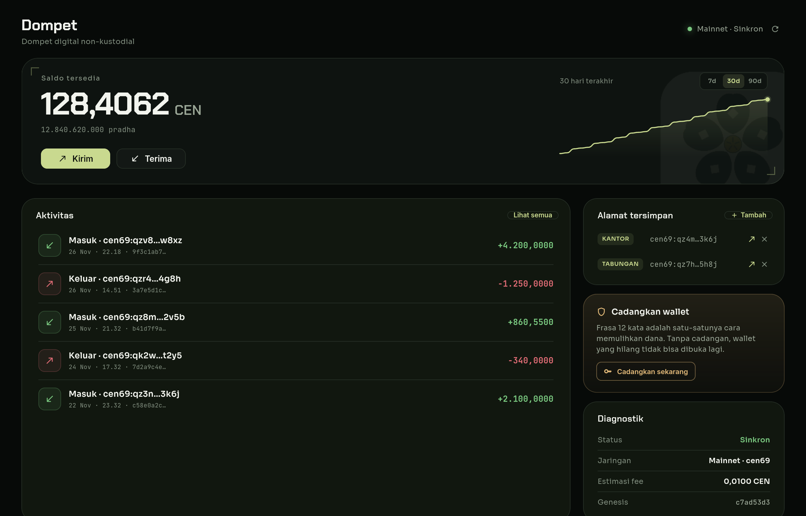
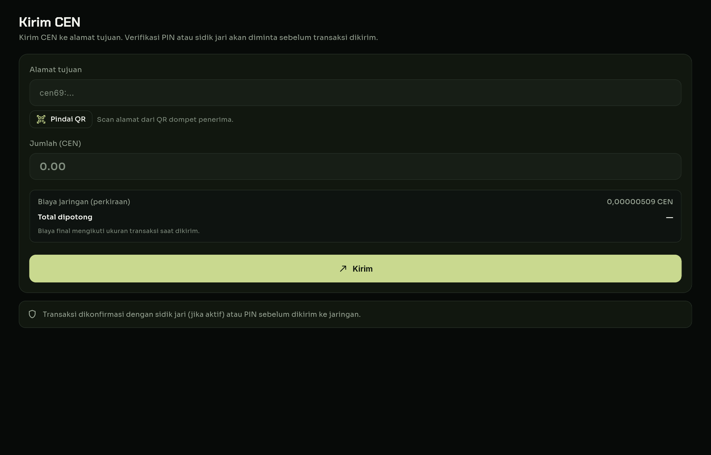
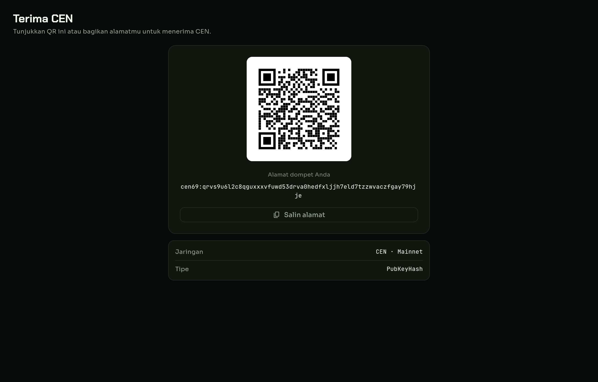
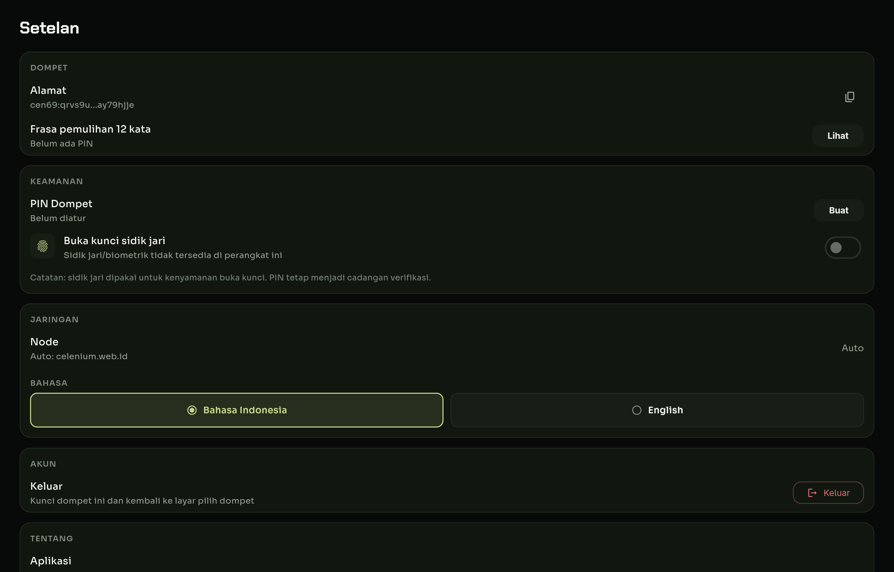

# Celenium Wallet



Celenium Wallet is a desktop wallet for the Celenium (CEN) mainnet. Recovery phrases, wallet lists, and the PIN are stored locally with flutter_secure_storage. Balances, transaction history, and send-fee estimates come from the bridge at https://celenium.web.id.

Version 1.0.3+4, built with Flutter 3.47.8 and Dart 3.13.7.

## Fitur

- Membuat dompet baru atau memulihkan dompet dengan frasa BIP39.
- Mengirim CEN ke alamat tujuan. Biaya kirim dihitung otomatis oleh bridge.
- Menerima CEN melalui alamat dan kode QR, serta memindai kode QR untuk mengisi alamat tujuan.
- Menampilkan riwayat transaksi masuk dan keluar.
- Menyimpan, menambah, dan menghapus alamat yang sering digunakan.
- Mengunci aplikasi dengan PIN atau biometrik, mengubah PIN, dan menghapus PIN.
- Menampilkan dan menyalin frasa pemulihan setelah autentikasi.
- Antarmuka bahasa Indonesia dan Inggris, dengan tata letak yang menyesuaikan jendela desktop dan ukuran layar kecil.

## Tampilan





## Prasyarat

- Flutter 3.47.8 atau versi lain yang kompatibel dengan Dart 3.13.7.
- Windows 10/11 64 bit, Visual Studio 2022 dengan beban kerja Desktop development with C++, CMake 3.14 atau lebih baru, dan Windows 10 SDK. Inno Setup 6 hanya diperlukan untuk membuat installer.
- Linux: clang, cmake, ninja-build, libgtk-3-dev, pkg-config, python3 dengan Pillow, dan appimagetool.

Jalankan `flutter pub get` sebelum build pertama.

## Build di Windows

Jalankan perintah berikut dari folder proyek menggunakan PowerShell.

```powershell
flutter pub get
flutter build windows --release
```

Hasil ada di `build\windows\x64\runner\Release\`. Salin seluruh folder tersebut, bukan hanya `celenium_wallet.exe`, karena ada berkas DLL dan folder data di dalamnya.

Untuk menghasilkan installer:

```powershell
.\build-windows-installer.bat
```

Skrip menjalankan `flutter clean`, `flutter pub get`, `flutter build windows --release`, lalu Inno Setup. Installer disimpan di `installer-out\Celenium-Wallet-Setup-1.0.3.exe`.

Skrip mengasumsikan Flutter berada di `C:\flutter\bin\flutter.bat`. Jika lokasinya berbeda, sesuaikan jalur tersebut atau jalankan tahapnya satu per satu:

```powershell
flutter clean
flutter pub get
flutter build windows --release
& "C:\Program Files (x86)\Inno Setup 6\ISCC.exe" windows\installer.iss
```

## Build di Linux

Bundle biasa:

```bash
flutter pub get
flutter build linux --release
build/linux/x64/release/bundle/celenium_wallet
```

AppImage:

```bash
chmod +x linux/packaging/build-appimage.sh
./linux/packaging/build-appimage.sh
```

Skrip menulis identitas aplikasi, menjalankan build Flutter, merakit AppDir, membuat AppRun, lalu memanggil appimagetool. Hasilnya `dist/CeleniumWallet-x86_64.AppImage`.

Secara bawaan skrip memakai Flutter di `$HOME/flutter-install/flutter/bin/flutter` dan appimagetool di `/tmp/appimagetool.AppImage`. Keduanya dapat diganti:

```bash
FLUTTER=/path/ke/flutter APPIMAGETOOL=/path/ke/appimagetool.AppImage ./linux/packaging/build-appimage.sh
```

Untuk merakit ulang AppImage dari bundle yang sudah ada tanpa menjalankan build Flutter lagi:

```bash
SKIP_FLUTTER=1 ./linux/packaging/build-appimage.sh
```

## Pengujian

```bash
flutter test
```

Per 26 November 2026, seluruh 26 pengujian lulus dengan Flutter 3.47.8.

## Identitas build

Nama aplikasi, publisher, App ID, AUMID, nama berkas eksekusi, dan ikon berasal dari `tool/build_meta.json`. Nomor versi berasal dari `pubspec.yaml`. Jangan menyunting `windows/runner/Runner.rc`, `windows/installer.iss`, `linux/packaging/CeleniumWallet.appdata.xml`, atau `CeleniumWallet.desktop` secara manual.

```bash
python3 tool/build_meta.py show
python3 tool/build_meta.py stamp
python3 tool/build_meta.py check
```

`stamp` menulis ulang identitas ke berkas-berkas build dan aman dijalankan berulang. `check` menghentikan build apabila ada nilai yang belum sinkron.

## Keamanan

Jangan pernah membagikan frasa pemulihan. Celenium Wallet tidak mengirim frasa tersebut ke bridge. Siapa pun yang memiliki frasa itu dapat memindahkan saldo Anda.
